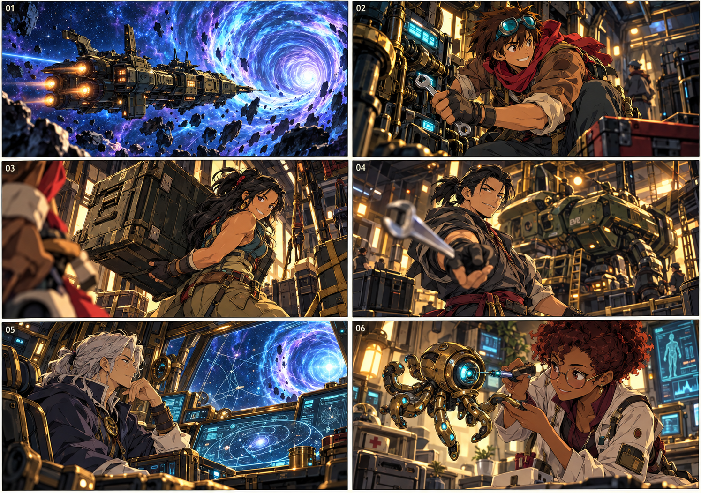
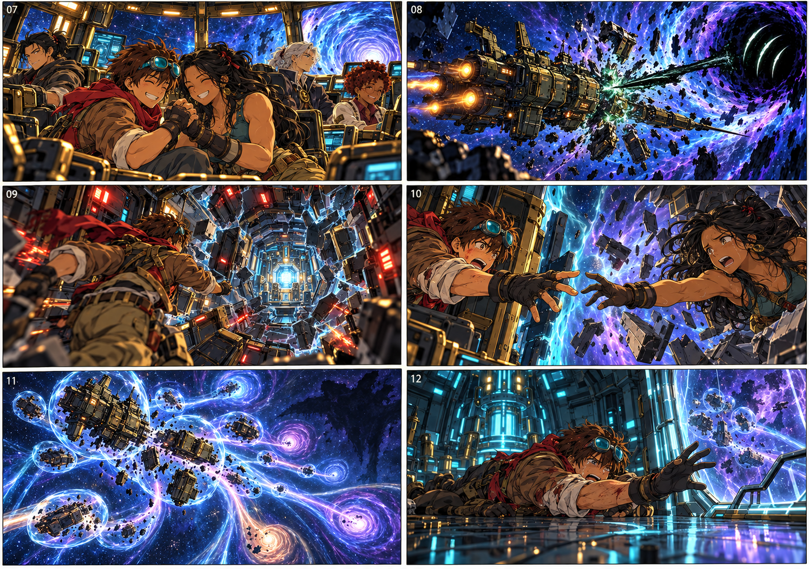
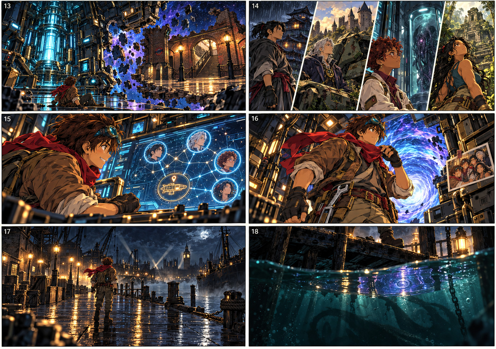

# Severence — Ecos do Tempo: cinemática inicial

Versão 1.1 — roteiro e storyboard de produção; falas e direção de atuação ajustadas às personalidades de Marty e Letícia.

**Duração proposta:** 2min12s. **Formato dos planos:** 16:9. **Estilo:** aventura em anime desenhado, fundos pintados, expressões claras, fantasia e horror cósmico. **Entrega:** roteiro e imagens estáticas; a animação, as vozes e a trilha ainda precisam ser produzidas.

## Intenção

O jogador conhece cinco amigos trabalhando juntos antes de vê-los separados. A abertura termina no Desembarque das Docas de 1941, no ponto em que assume Marty. A missão fica clara: encontrar os quatro companheiros e os equipamentos espalhados pelas eras. A identidade da Ordem, a transformação de Elias e o confronto final com Cthulhu permanecem descobertas da campanha.

O mini-chefe e o chefe das Docas aparecem durante a fase, depois desta abertura. A cinemática não concede resgates nem recompensas.

## Identidade visual desta proposta

- **Marty:** adulto jovem com **1,80 m de altura**, cabelo castanho espetado, goggles ciano, lenço vermelho, jaqueta marrom com gola clara. Pode aparecer com ou sem barba ao longo da aventura; manter a continuidade dentro de cada sequência. Nas pranchas atuais da abertura, está sem barba. Mecânico da equipe; resolve problemas com as mãos.
- **Letícia:** mulher adulta baixinha, com **1,50 m de altura**, traços indígenas, pele morena, cabelos pretos longos presos parcialmente por um cordão vermelho, corpo forte e levemente musculoso. Mostrar a diferença de 30 cm em relação a Marty quando estiverem no mesmo plano. Na nave, colete prático verde-petróleo, calça ocre e faixas nos pulsos. O figurino da expedição antecede as roupas adquiridas em sua era.
- **Vincent:** adulto de cabelos pretos presos em rabo curto, uniforme cinza e faixa utilitária vinho. Antes do acidente, ainda não tem sua katana nem o aspecto envelhecido do samurai que Marty encontrará.
- **Elias:** adulto esguio, cabelo branco-prateado preso, casaco de piloto índigo e fecho circular de bronze. Ainda não usa roupas de mago nem lança feitiços.
- **Íris:** mulher adulta de pele negra, cabelo curto cacheado castanho-avermelhado, óculos redondos, jaqueta médica marfim sobre roupa ameixa.
- **Spectre:** pequeno polvo mecânico de latão, oito apêndices e núcleo/olho ciano. A abertura mostra sua forma anterior aos experimentos.

As características novas de Vincent, Elias e Íris são propostas visuais para esta versão. Repetir os mesmos rostos e cores entre os planos. O mecha usado por Elias no acidente não precisa ser identificado como Titan: há equipamentos distintos na expedição.

## Parte 1 — Quando estavam juntos (00:00–00:32)

**Direção de atuação:** Marty tem o carisma, a ousadia e o humor defensivo de um aventureiro como Peter Quill. Suas falas devem soar espontâneas; as pausas deixam transparecer o medo quando perde os amigos. Letícia é calorosa e bem-humorada, mas muda para um tom firme diante de desleixo ou risco evitável. A cobrança dura um instante e tem um motivo concreto. A parceria e o carinho sustentam o casal. Durante a separação, a solidão e a promessa de resgate, deixar a emoção acontecer sem inserir piadas.

### 01 · A travessia · 00:00–00:06

**Imagem:** uma nave pequena diante de um imenso buraco de minhoca ciano e violeta. A câmera acompanha a nave por trás e deixa perceber a escala do fenômeno.

**Som:** motor grave, uma melodia curta e calorosa de quatro notas. Sem narração.

**Elias, pelo rádio:** “Travessia em trinta segundos. Todo mundo pronto?”

### 02 · Marty · 00:06–00:11

**Imagem:** Marty ajoelhado diante de um painel aberto. Aperta uma peça com a chave; a luz instável fica firme. Ele levanta os goggles e sorri.

**Marty:** “Pronto. Obra de um gênio.”

**Som:** clique da ferramenta, motor regularizando. Entrada discreta do nome MARTY, colocada na edição.

### 03 · Letícia · 00:11–00:16

**Imagem:** uma caixa pesada se solta com a vibração da nave. Letícia a segura e empurra de volta ao suporte. Percebe a trava aberta e lança a Marty um olhar firme. Ele tenta uma piada, mas se aproxima para fechar a trava; ela confere o encaixe e contém um sorriso. A falta da trava é um pequeno descuido com a carga, sem relação com o ataque que vem depois.

**Letícia:** “Marty. Faltou a trava.”

**Marty, fora de quadro:** “Teste de reflexo. Passou!”

**Som:** a caixa encaixa, seguida do clique da trava. Nome LETÍCIA na edição. Letícia fala com firmeza, sem gritar; a ação de Marty mostra que ele atende à cobrança.

### 04 · Vincent · 00:16–00:21

**Imagem:** Vincent termina de prender a carga no hangar. Um mecha repousa ao fundo. Ele lança uma chave sobressalente para Marty, fora do quadro.

**Vincent:** “Leva outra. Só por garantia.”

**Som:** ferramenta girando e sendo apanhada. Nome VINCENT na edição. Sua descontração estabelece contraste com o homem experiente do futuro resgate.

### 05 · Elias · 00:21–00:27

**Imagem:** Elias no posto de navegação, iluminado por uma espiral de coordenadas. O sorriso diminui: uma marca escura aparece por um instante dentro da espiral e some. Ele confere o monitor.

**Elias, baixo:** “Estranho…”

**Som:** um pulso fora do ritmo do motor. A melodia continua. Nome ELIAS na edição.

### 06 · Íris e Spectre · 00:27–00:32

**Imagem:** Íris examina o olho do pequeno Spectre. Ele tenta roubar o instrumento com um apêndice. Ela recupera o aparelho com cuidado.

**Íris:** “Você também está na lista de pacientes.”

**Som:** resposta eletrônica do Spectre. Nome ÍRIS na edição.

## Parte 2 — A fratura (00:32–01:12)

### 07 · A promessa · 00:32–00:40

**Imagem:** os cinco se reúnem junto à ponte. Elias retorna ao comando; Íris e Spectre ficam perto da entrada, Vincent confere a trava. Letícia encosta o ombro no de Marty e segura sua mão por um momento.

**Letícia:** “Na volta, você me deve um dia sem consertar nada.”

**Marty:** “Encontro marcado. Sem ferramentas.”

**Som:** a melodia da equipe chega ao ponto mais acolhedor. A luz do buraco de minhoca cobre os rostos.

### 08 · Algo estava esperando · 00:40–00:45

**Imagem:** exterior. Um círculo escuro, marcado por três cortes curvos, aparece dentro do buraco de minhoca. Uma descarga atravessa o casco de lado. A origem do ataque permanece fora de quadro.

**Elias, pelo rádio:** “Isso não é turbulência!”

**Som:** impacto seco, alarme e um ruído parecido com um coro muito distante. A música se interrompe.

### 09 · A nave se abre · 00:45–00:50

**Imagem:** corredores se dobram como reflexos partidos; tubulações e luzes se separam em linhas impossíveis. Marty corre até o painel de emergência. A porta entre ele e os amigos perde a forma.

**Marty:** “Todo mundo para a sala do núcleo!”

**Som:** metal rompendo, alarme desacelerando de maneira anormal. Evitar flashes estroboscópicos.

### 10 · Quase · 00:50–00:57

**Imagem:** Letícia impulsiona o corpo na direção de Marty. Ele se estica para alcançá-la. O enquadramento aproxima as mãos: os dedos quase se tocam, mas uma fratura luminosa abre distância entre eles.

**Letícia:** “Marty!”

**Som:** a voz se alonga. Por um breve instante, quase todo o áudio desaparece. Sustentar a imagem das mãos antes do corte.

### 11 · Espalhados · 00:57–01:04

**Imagem:** a nave se rompe em placas e fragmentos dentro da espiral. Cápsulas e seções do casco são arrastadas para passagens distintas; silhuetas dos companheiros permanecem protegidas por bolsões de energia. Ao fundo, algo imenso parece mover-se para além das estrelas, sem revelar rosto ou corpo.

**Som:** batida grave e vozes incompletas sobrepostas. Não nomear Cthulhu nem explicar o culto.

### 12 · A sala que ficou · 01:04–01:12

**Imagem:** Marty cai para dentro da sala do núcleo. Um campo de emergência fecha a passagem atrás dele. Pela janela, o que resta da nave desaparece. A sala permanece intacta, suspensa no vazio.

**Marty:** “Letícia? Vincent? …Alguém?”

**Som:** rádio sem resposta. Um estalo do núcleo. Escurecimento gradual, como perda de consciência.

## Parte 3 — O primeiro sinal (01:12–02:12)

### 13 · Fora do tempo · 01:12–01:22

**Imagem:** Marty desperta. Poeira e pequenos destroços flutuam do lado de fora. A sala do núcleo está ligada a uma plataforma de estação arrancada de outro lugar, com escadas e trilhos interrompidos no vazio. A câmera se afasta para revelar o futuro Refúgio.

**Marty, no comunicador:** “Aqui é o Marty. Estou na sala do núcleo. Respondam.”

**Som:** respiração, ventilação fraca, rádio. O núcleo pulsa uma vez.

**Continuidade:** a estabilização da sala junto à primeira fratura incorporou um trecho do metrô de Londres de 1941. A imagem mostra a junção de metal da nave e alvenaria da estação; o diálogo não precisa explicar isso neste momento.

### 14 · Em outros tempos · 01:22–01:34

**Imagem:** quatro visões de três segundos, mostradas ao público, não como informação já conhecida por Marty. Vincent jovem e molhado diante de uma aldeia japonesa; Elias ao pé de seu mecha avariado, observado por pessoas de um reino medieval; Íris numa sala de observação, com Spectre atrás de outro vidro; Letícia abrindo caminho por uma floresta junto a ruínas antigas. São instantes de destinos diferentes, sem afirmar que ocorrem ao mesmo tempo.

**Som:** chuva; sino distante; zumbido de lâmpadas; vento entre folhas. Sem falas. No storyboard, um único quadro reúne as quatro imagens; na montagem, são quatro cortes sucessivos.

### 15 · Os sinais · 01:34–01:46

**Imagem:** de volta à sala. Marty limpa a tela quebrada e reconecta um cabo. Surgem quatro identificadores da equipe, cada um associado a uma coordenada instável. Um quinto sinal, de equipamento, se fixa em Londres, 1941. Pequenas imagens dos amigos no cadastro recuperam a memória da cena 07.

**Sistema, voz simples e entrecortada:** “Quatro assinaturas da tripulação detectadas. Coordenadas temporais instáveis.”

**Marty:** “Vocês estão aí…”

**Sistema:** “Primeiro destino acessível: Londres. Mil novecentos e quarenta e um.”

**Tela na edição:** TRIPULAÇÃO: 4 SINAIS · EQUIPAMENTO LOCALIZADO · DOCAS / 1941. As assinaturas são rastros temporais, não um diagnóstico de que todos estão seguros.

### 16 · A escolha de Marty · 01:46–01:55

**Imagem:** Marty coloca a ferramenta no cinto e prepara uma arma de emergência. Olha para a foto dos cinco presa junto ao console. O núcleo forma uma porta ciano e violeta.

**Marty:** “Eu vou encontrar vocês. Um por um.”

**Som:** a melodia de quatro notas retorna em um único instrumento. Passos firmes em direção à porta.

### 17 · Docas, 1941 · 01:55–02:05

**Imagem:** Marty atravessa a porta e desembarca no píer molhado. Farol, guindastes e armazéns recortam a noite. A câmera começa próxima dele e sobe lentamente em direção ao enquadramento do jogo. A passagem para o Refúgio permanece visível atrás.

**Som:** goteiras, motor de barco distante e uma sirene que para no meio da nota. Inserção discreta na edição: LONDRES · 1941.

### 18 · O mar escuta · 02:05–02:12

**Imagem:** um último plano rente à água mostra uma sombra enorme cruzando sob o píer. Reflexos das estrelas formam por um instante a mesma marca do ataque. Corte ao título, SEVERENCE — ECOS DO TEMPO, por três segundos. Retorno à posição de Marty no Desembarque e entrada do controle do jogador.

**Som:** madeira rangendo; um sussurro indistinto; depois, apenas a ambiência do porto. Sem explicação em voz alta.

**Primeiro objetivo jogável:** “Investigue o sinal do equipamento nas Docas.” O tutorial de movimento começa quando o jogador recebe o controle.

## Orientações de montagem

- Os números nas pranchas identificam os planos; nomes, legendas e título devem ser adicionados na edição, com fonte legível.
- Para um animatic, recortar cada quadro na ferramenta de edição escolhida, aplicar movimentos suaves de câmera e usar os tempos acima. A sequência 14 precisa de quatro cortes dentro de seus 12 segundos.
- As pranchas são quadros-chave. Não contêm camadas separadas nem os desenhos intermediários necessários para animação completa.
- Manter a relação espacial entre Marty na sala do núcleo e Letícia do outro lado da fratura. A mão interrompida na cena 10 deve recordar a mão segura na cena 07.
- As manifestações de Cthulhu devem permanecer incompletas. Não usar a revelação frontal da criatura da prancha conceitual anterior nesta abertura.
- Reproduzir a abertura uma vez ao iniciar uma nova campanha; oferecer pausa, legendas e opção de pular. Quem pula começa no mesmo ponto jogável e recebe o mesmo objetivo.

## Relação com o storyboard anterior

O arquivo `STORYBOARD_ABERTURA.md` registra um teaser de divulgação com reencontros e combate. Esta cinemática conta o início cronológico da campanha e usa imagens próprias. Os dois materiais têm finalidades diferentes.
