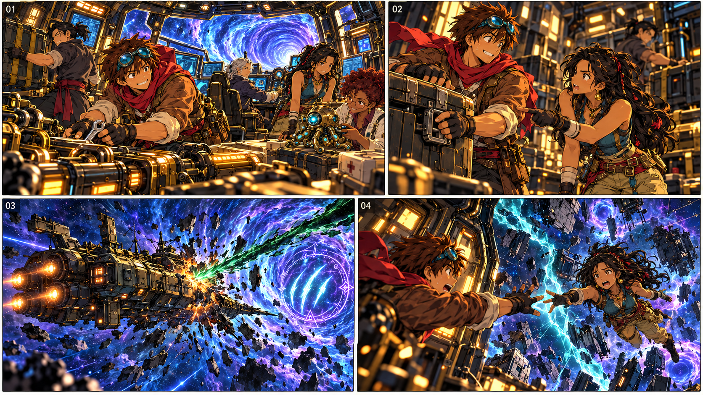
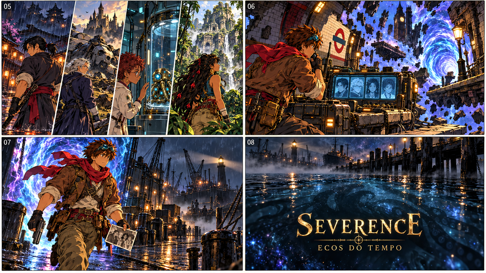
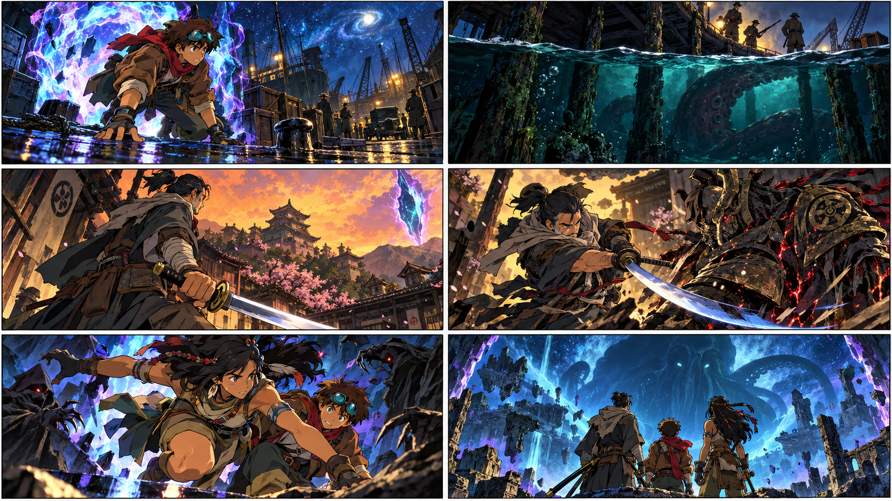

# Storyboard — Severence — Ecos do Tempo

## Intro atual — 60 segundos

Oito quadros seguem o roteiro de um minuto. Cada quadro representa um trecho que pode conter mais de um corte. O título da cartela final é **SEVERENCE — ECOS DO TEMPO**, sem o nome do protagonista.

| Quadro | Tempo | Imagem e ação | Falas e som |
|---|---|---|---|
| 01 | 00–08s | Nave se aproxima do buraco de minhoca. Vincent prende equipamentos, Elias pilota, Íris examina Spectre; Marty fecha o painel. | Marty: “Pronto. Obra de um gênio.” Motor e música acolhedora. |
| 02 | 08–15s | Letícia segura uma caixa que desliza e aponta a trava. Marty a prende. Mostrar sua diferença de altura quando estiverem no mesmo plano. | Letícia: “O gênio esqueceu a trava.” Marty: “Eu sabia que faltava um detalhe.” Um alarme interrompe a brincadeira. |
| 03 | 15–23s | Símbolo escuro surge no buraco de minhoca. Uma descarga atinge a nave; as paredes se partem em fraturas luminosas. | Elias: “Estão atirando na gente!” Marty: “Todo mundo para a sala do núcleo!” |
| 04 | 23–31s | As mãos de Marty e Letícia quase se tocam, mas uma fissura os separa. A nave se fragmenta em passagens diferentes. | Letícia: “Marty!” O som se apaga com a explosão. |
| 05 | 31–39s | Quatro cortes rápidos: Vincent no Japão; Elias e o mecha junto ao castelo; Íris no laboratório; Letícia nas ruínas da floresta. A sala de Marty fica suspensa no vazio. | Chuva, sino, zumbido do laboratório e vento. Sem falas. A montagem em quatro faixas representa cortes sucessivos. |
| 06 | 39–49s | Marty desperta, usa o rádio; quatro sinais aparecem no painel. Uma porta começa a se abrir. | Marty: “Pessoal… alguém me escuta?” Sistema: “Sinais da tripulação detectados.” |
| 07 | 49–56s | Marty olha a foto dos cinco, guarda a ferramenta, prepara a arma e atravessa a porta para as Docas de 1941. | Marty: “Eu vou encontrar vocês. Um por um.” O tema da equipe retorna suavemente. |
| 08 | 56–60s | Sombra colossal sob o píer. Cartela SEVERENCE — ECOS DO TEMPO. Título desaparece e a câmera assume a posição do jogo. | Sirene interrompida; ambiência das Docas. O jogador recebe o controle aos 60s. |

As duas pranchas são imagens estáticas para orientar a montagem, não um vídeo pronto. Os números dos quadros são guias de edição. Preservar as durações acima; a cartela ocupa parte dos últimos quatro segundos. Esta versão curta é a referência atual para a intro; o roteiro de 2min12s permanece como versão longa anterior.

## Teaser conceitual anterior

As três imagens fornecidas pelo usuário orientam o clima de fantasia em anime, as poses de ação e os enquadramentos dramáticos. Os personagens e as cenas do storyboard são originais do jogo.

| Quadro | Imagem e ação | Som / função narrativa |
|---|---|---|
| 1 | Marty sai da fenda ciano e violeta e cai no píer das Docas de 1941. | Estrondo abafado da nave; sirene de guerra interrompida. Mostra a chegada à primeira fase. |
| 2 | A câmera mergulha sob o píer. Algo imenso se move na água, sem revelar o corpo inteiro. | Silêncio súbito, madeira rangendo e uma voz indistinta. Introduz o horror cósmico. |
| 3 | Em outra era, Vincent encara uma fenda sobre um vilarejo japonês. A espada já faz parte de sua vida. | Vento e sinos. Revela que o tempo passou de modo diferente para ele. |
| 4 | Vincent enfrenta um guardião corrompido. | Choque de metal. Demonstra seu estilo de espada e um mini-chefe da fase. |
| 5 | Letícia salta diante de Marty e o protege de criaturas da fratura. | Corte rápido da música, impacto e retorno do tema da equipe. Mostra sua força e velocidade. |
| 6 | Os três olham para uma abertura gigantesca acima do Refúgio. A forma de Cthulhu aparece distante e incompleta. | Nota grave sustentada. Anuncia a ameaça final sem explicá-la toda. |

Este é um storyboard conceitual de apresentação da história, não uma sequência já implementada nem a ordem obrigatória de resgate dos personagens.
